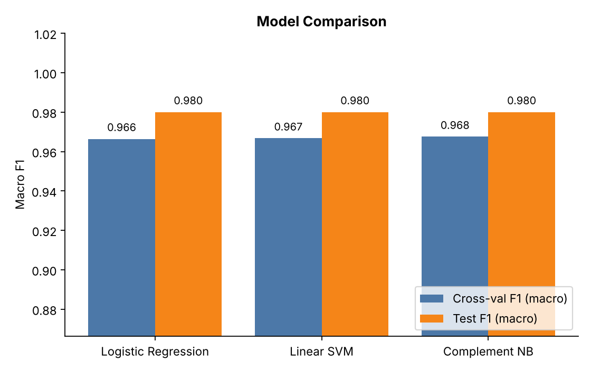

# 💬 Social Media Sentiment Analyzer

End-to-end machine learning project that classifies social media posts as **positive, neutral or negative**.
It includes a social-media-aware text pipeline, automatic model comparison and tuning, a CLI, a Streamlit
dashboard with batch scoring, per-prediction explanations and a test suite.



## Highlights

- **Social-media-aware preprocessing** (`src/preprocessing.py`): URLs, @mentions, hashtags, emojis,
  elongated words (`soooo`), contractions, **negation scope handling** (`not good` -> `NOT_good`) and
  **Hinglish** slang. No NLTK downloads needed.
- **Model selection done properly** (`src/train.py`): Logistic Regression, Linear SVM and Complement NB, each tuned with
  `GridSearchCV` (stratified CV, macro-F1). The winner is chosen on **cross-validation, not the test set**,
  so the test score stays an honest estimate.
- **Explainable**: every prediction shows the words that pushed it towards the predicted class.
- **Three ways to use it**: Python API, command line, Streamlit dashboard (single post + CSV batch + insights).
- **Zero setup friction**: the dataset ships with the project and the model trains itself on first run.

## Quick start (VS Code)

1. Unzip and open the folder in VS Code (`File -> Open Folder`).
2. Open a terminal (`Ctrl + ~`) and create a virtual environment:

   **Windows**
   ```powershell
   python -m venv .venv
   .venv\Scripts\activate
   pip install -r requirements.txt
   ```
   **macOS / Linux**
   ```bash
   python3 -m venv .venv
   source .venv/bin/activate
   pip install -r requirements.txt
   ```
3. Pick the interpreter: `Ctrl+Shift+P` -> **Python: Select Interpreter** -> choose `.venv`.
4. Run it:
   ```bash
   python -m src.train                       # train + evaluate (~10 s), saves model and reports
   python -m src.predict "Loving this phone!" "Worst service ever"   # CLI
   streamlit run app.py                      # dashboard at http://localhost:8501
   pytest                                    # run the tests
   ```

You can also use the **Run and Debug** panel (`F5`): launch configs for training, prediction, the dashboard and tests are
already set up in `.vscode/launch.json`.

## Project structure

```
social-sentiment-analyzer/
├── app.py                  # Streamlit dashboard
├── config.py               # paths, labels, seeds
├── data/
│   └── social_media_posts.csv   # bundled dataset (4,500 posts)
├── src/
│   ├── preprocessing.py    # social-media text cleaning
│   ├── data.py             # dataset generator + loader
│   ├── train.py            # tuning, comparison, persistence
│   ├── evaluate.py         # confusion matrix / comparison plots
│   ├── model_utils.py      # explainability helper
│   └── predict.py          # inference API + CLI
├── tests/                  # pytest suite
├── models/                 # trained model (created by training)
├── reports/                # metrics.json, plots (created by training)
└── .vscode/                # launch + settings
```

## Use as a library

```python
from src.predict import get_predictor

p = get_predictor()
p.predict("Bhai ye app bakwas hai yaar")
# {'sentiment': 'negative', 'confidence': 0.99, 'probabilities': {...}}
p.explain("Bhai ye app bakwas hai yaar")   # [('bakwas', 1.23), ...]
```

## Train on real data (recommended for real-world use)

The bundled dataset is **synthetic** (template-generated with emojis, hashtags, noise, Hinglish and 3% label noise)
so the project works offline. Because of that, the ~98% score reflects an easy, clean problem and
**will not carry over to real tweets**. For real-world performance, train on real data such as
[Sentiment140](https://www.kaggle.com/datasets/kazanova/sentiment140) or any labelled tweet/review CSV:

```bash
python -m src.train --data path/to/tweets.csv --text-col text --label-col sentiment
```

Labels `0/2/4`, `-1/0/1` or `negative/neutral/positive` are mapped automatically. Expect roughly 75-82% accuracy
with this classical approach on real Twitter data. Fine-tuning a transformer (e.g. `cardiffnlp/twitter-roberta-base-sentiment`)
is the natural next step to go beyond that.

## Tech stack

Python - scikit-learn - pandas - NumPy - Matplotlib - Streamlit - pytest

## Roadmap ideas

- Transformer-based model (BERT / RoBERTa) and comparison against the TF-IDF baseline
- Live tweet / Reddit ingestion with sentiment-over-time charts
- Sarcasm detection and multilingual support
- Docker image and CI workflow
